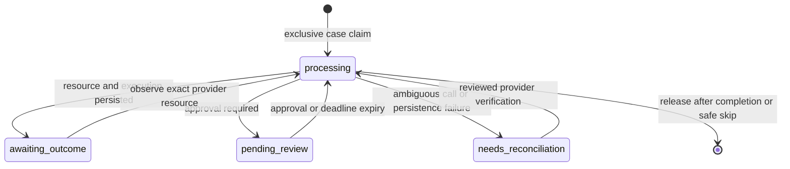

# Architecture and evidence contract

RecoverAI is a Test Mode recovery prototype. The classifier is logistic
regression; diagnosis, eligibility, scoring and workflow transitions are
explicit Python rules. No LLM, autonomous coding agent or production merchant
revenue claim is part of this implementation.

## Code map

| Responsibility | Implementation |
| --- | --- |
| Private operator API and authenticated checkout | `app/main.py`, `app/api/auth.py` |
| Public signed-event listener | `app/webhook_gateway.py`, `app/api/webhooks.py` |
| Provider ingestion and deterministic diagnosis | `app/services/ingestion.py`, `diagnosis.py` |
| Model probabilities and shared pure selection | `app/services/ml_service.py`, `policy.py`, `decision.py` |
| Case/retry eligibility and exact money conversion | `app/services/eligibility.py`, `money.py` |
| Automatic and human-approved execution | `app/services/execution.py`, `order_service.py` |
| Durable claims and execution attribution | `reservations.py`, `execution_records.py`, `app/models/models.py` |
| Early-event storage and bounded replay | `webhook_inbox.py`, `webhook_replay.py`, `scripts/replay_webhooks.py` |
| Reviewed settlement of verified success | `app/services/reconciliation.py`, `app/ui/reconciliation.py` |
| Transactional review expiry | `escalation.py`, `review_maintenance.py`, `scripts/maintain_reviews.py` |
| Matched evaluation and recorded evidence display | `ML/benchmark_policies.py`, `benchmark_reporting.py`, `app/ui/policy_benchmark.py` |
| Isolated deterministic demonstration | `scripts/offline_demo.py`, `demo_provider.py`, `render_demo_html.py` |

Paths without a directory in this table are under `app/services`.

## Separate provider payment state from case state

`Payment.razorpay_state` describes the original charge. `Payment.status`
describes the recovery case. A failed original charge can therefore retain
provider state `failed` while the case becomes `recovered` through another
verified payment. Re-ingestion preserves recovered/closed case status.

Successful, authorized, closed or out-of-window cases cannot start new recovery
work. A verified late capture is still allowed to settle an earlier execution,
including after a case was closed unrecovered.

## Case claim lifecycle

This is the reservation lifecycle, not the payment/provider state machine.
Claims use database uniqueness/conditional updates, not process-local locks.
An uncertain `processing` claim does not expire merely because it is old: the
owner might still be running or the provider might already have accepted work.

Review expiry takes the same case claim as approval. Review status, failed-case
closure, audit and claim cleanup commit together. It never authorizes a
provider action. Another live or uncertain phase is not taken over.

## One provider resource, one attributable execution

1. A recovery intent is committed before contacting the provider.
2. The request includes that intent reference in provider notes.
3. The resource ID, executed Action and audit are bound to RecoveryExecution.
4. ExecutionOutcome uniquely binds an Outcome to that execution.
5. Provider ID, amount and currency are checked before success is accepted.

Human review recommendations and executed actions are separate Action rows.
An approved execution uses `decision_type=auto` as the existing executed-action
category; `human_approved_executed` in audit identifies how it was authorized.
Recommendations do not consume executed-retry budgets or cooling-off time.
Automatic and human decisions exclude an action type once it has been executed.

Created requests and execution expectations use integer paise. SQLite Payment
amounts remain rupee display values; this prototype is not an accounting ledger.

A late success updates the earlier execution's failed result and settles the
original case. It does not rewrite a newer execution's result. Pending reviews
are expired, but other already-issued provider resources are not automatically
cancelled. Database claims do not guarantee exactly-once external charges.

## Event inbox and replay

Only events with a valid signature and usable event/payment identity enter the
inbox. It retains event type, payment/order IDs and a recognized link reference;
contacts, cards, signatures and arbitrary purchase descriptions are excluded.
An event ID cannot be rebound to different correlation data.

An unmatched capture waits for execution persistence. A failed recovery event
can be recognized from its intent, including before a creation response is
stored, rather than becoming a second independent recovery case. A second
correlation check handles a creator committing during that lookup.

Replay uses normal event/case claims, backs off, and retains unresolved events
for review after 20 processing attempts. Interrupted and reconciliation claims
are not forced. Ordinary unrelated captures can remain unmatched and need
investigation; this inbox is not a promise to resolve every provider event.

## Reconciliation is a provider check, not a retry button

The operator selects an existing execution or intent. If a response was lost,
an existing provider ID can be supplied; its notes must match the intent.
Checks read the provider and compare ID, amount, currency and full payment.
Settlement re-fetches evidence under an exclusive reconciliation claim.

Only verified success settles a case. Failed/pending/unavailable/mismatched
results stay blocked and cannot trigger another external action. Processing
claims, ambiguous history and uncertain webhooks are not forcibly reset.
Successful settlement records the operator in audit. It does not automatically
replay a held webhook or cancel another resource.

## Model evaluation and policy evaluation answer different questions

The classifier report describes probability quality on disjoint synthetic
contexts. Its ROC-AUC is not a recovery-rate or merchant-revenue metric.

The matched policy benchmark refits the training recipe on five predefined
group splits. Each test context has one fixed synthetic label for all three
actions. Selectors see features and probabilities, not those labels. Every
policy gets the same costs and maximum of one intervention. The baseline does
not use the evaluated model's probabilities as an outcome generator.

`ml_guarded` calls the same pure selector as the app. `ml_value_only` is an
ablation without confidence deferral. Deferred reviews remain unresolved, so
automatic results cannot be treated as full post-review workflow performance.
The dataset lacks retry-specific history and cooling-off timestamps; assumptions
for those fields are explicit. Costs are modeled intervention costs, not a
provider fee schedule. Live customer history has not been independently validated.

Primary-split paired bootstrap intervals describe uncertainty in that synthetic
sample, conditional on the model. Repeated split test groups overlap; their
counts cannot be pooled. The current result does not establish an ML advantage
over fixed cause rules. No policy/threshold was tuned after seeing this result.

## Actual Test Mode verification versus offline demonstration

The 4 November hosted checkout record is an actual provider-origin Test Mode
exercise. Later local regressions are not additional real provider deliveries.

The offline runner starts with fresh configuration in its own process, creates
a new SQLite file, substitutes a deterministic provider, and blocks external
networking (Windows local IPC is allowed). It refuses to reuse an existing DB
or already-loaded app configuration. The merchant DB and `.env` are unchanged.

Its HTML is a replay of recorded evidence, not a live backend simulator. JSON
artifacts carry model/source fingerprints. CI executes the scenarios again;
the legacy `scripts.live_demo` entry point now uses this safe runner.

## Operational limits

Workers must be running and supervised for continuous operation. Startup-service
registration, automatic pending-outcome polling, lease-based crash recovery,
provider cleanup, versioned migrations, dependency locks and a real merchant
pilot remain separate work. Operator APIs/dashboard need deployment controls
before public exposure. These limits are part of the project evidence, not
features claimed to be complete.
