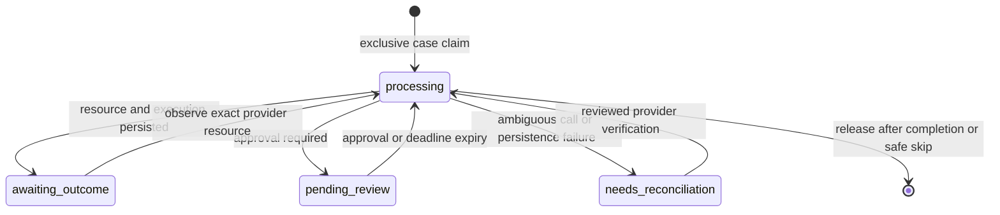

# Architecture and evidence contract

RecoverAI is a payment-recovery application verified in Razorpay Test Mode.
The classifier is logistic regression; diagnosis, eligibility, scoring and workflow transitions are
explicit Python rules. No LLM, autonomous coding agent or production merchant
revenue claim is part of this implementation.

## Code map

| Responsibility | Implementation |
| --- | --- |
| Private operator API and authenticated checkout | `app/main.py`, `app/api/auth.py` |
| Public signed-event listener | `app/webhook_gateway.py`, `app/api/webhooks.py` |
| Provider ingestion and deterministic diagnosis | `app/services/ingestion.py`, `diagnosis.py` |
| Model probabilities and shared pure selection | `app/services/ml_service.py`, `policy.py`, `decision.py` |
| Case/retry eligibility and exact money conversion | `app/services/eligibility.py`, `money.py` |
| Automatic and human-approved execution | `app/services/execution.py`, `order_service.py` |
| Original-order ownership, natural success and grouped reporting | `original_orders.py`, `order_reporting.py` |
| Persistent operator opt-out/cancellation/risk stops | `recovery_stops.py`, `app/ui/recovery_stops.py` |
| Authenticated dashboard checkout preview | `operator_checkout.py`, `app/ui/operator_checkout.py` |
| Versioned migrations, isolated restore and local supervision | `migrations/`, `scripts/verify_backup.py`, `scripts/run_local.py` |
| Durable claims and execution attribution | `reservations.py`, `execution_records.py`, `app/models/models.py` |
| Early-event storage and bounded replay | `webhook_inbox.py`, `webhook_replay.py`, `scripts/replay_webhooks.py` |
| Reviewed settlement of verified success | `app/services/reconciliation.py`, `app/ui/reconciliation.py` |
| Transactional review expiry | `escalation.py`, `review_maintenance.py`, `scripts/maintain_reviews.py` |
| Matched evaluation and recorded evidence display | `ML/benchmark_policies.py`, `benchmark_reporting.py`, `app/ui/policy_benchmark.py` |
| Isolated deterministic demonstration | `scripts/offline_demo.py`, `demo_provider.py`, `render_demo_html.py` |

Paths without a directory in this table are under `app/services`.

## Separate provider payment state from case state

`Payment.razorpay_state` describes the original charge. `Payment.status`
describes the recovery case. A failed original charge can therefore retain
provider state `failed` while the case becomes `recovered` through another
verified payment. Re-ingestion preserves recovered/closed case status.

Successful, authorized, closed or out-of-window cases cannot start new recovery
work. A verified late capture is still allowed to settle an earlier execution,
including after a case was closed unrecovered.

## Case claim lifecycle

This is the reservation lifecycle, not the payment/provider state machine.
Claims use database uniqueness/conditional updates, not process-local locks.
An uncertain `processing` claim does not expire merely because it is old: the
owner might still be running or the provider might already have accepted work.

Review expiry takes the same case claim as approval. Review status, failed-case
closure, audit and claim cleanup commit together. It never authorizes a
provider action. Another live or uncertain phase is not taken over.

## One provider resource, one attributable execution

1. A recovery intent is committed before contacting the provider.
2. The request includes that intent reference in provider notes.
3. The resource ID, executed Action and audit are bound to RecoveryExecution.
4. ExecutionOutcome uniquely binds an Outcome to that execution.
5. Provider ID, amount and currency are checked before success is accepted.

Human review recommendations and executed actions are separate Action rows.
An approved execution uses `decision_type=auto` as the existing executed-action
category; `human_approved_executed` in audit identifies how it was authorized.
Recommendations do not consume executed-retry budgets or cooling-off time.
Automatic and human decisions exclude an action type once it has been executed.

Created requests and execution expectations use integer paise. SQLite Payment
amounts remain rupee display values; this application is not an accounting ledger.

A late success updates the earlier execution's failed result and settles the
original case. It does not rewrite a newer execution's result. Pending reviews
are expired, but other already-issued provider resources are not automatically
cancelled. Database claims do not guarantee exactly-once external charges.

## Event inbox and replay

Only events with a valid signature and usable event/payment identity enter the
inbox. It retains event type, payment/order IDs and a recognized link reference;
contacts, cards, signatures and arbitrary purchase descriptions are excluded.
An event ID cannot be rebound to different correlation data.

An unmatched capture waits for execution persistence. A failed recovery event
can be recognized from its intent, including before a creation response is
stored, rather than becoming a second independent recovery case. A second
correlation check handles a creator committing during that lookup.

Replay uses normal event/case claims, backs off, and retains unresolved events
for review after 20 processing attempts. Interrupted and reconciliation claims
are not forced. Ordinary unrelated captures can remain unmatched and need
investigation; this inbox is not a promise to resolve every provider event.

## Reconciliation is a provider check, not a retry button

The operator selects an existing execution or intent. If a response was lost,
an existing provider ID can be supplied; its notes must match the intent.
Checks read the provider and compare ID, amount, currency and full payment.
Settlement re-fetches evidence under an exclusive reconciliation claim.

Only verified success settles a case. A separate reviewed-failure control re-reads
all known executions and the original order under the reconciliation claim. If
all executions are failed and the case is eligible, it records the failed outcome
and creates a manual-assessment review. It cannot call a creation endpoint;
a separate approval must select an untried eligible action. Pending, paid, partial,
unavailable or mismatched evidence remains blocked. Processing
claims, ambiguous history and uncertain webhooks are not forcibly reset.
Successful settlement records the operator in audit. It does not automatically
replay a held webhook or cancel another resource.

## Model evaluation and policy evaluation answer different questions

The classifier report describes probability quality on disjoint synthetic
contexts. Its ROC-AUC is not a recovery-rate or merchant-revenue metric.

The matched policy benchmark refits the training recipe on five predefined
group splits. Each test context has one fixed synthetic label for all three
actions. Selectors see features and probabilities, not those labels. Every
policy gets the same costs and maximum of one intervention. The baseline does
not use the evaluated model's probabilities as an outcome generator.

`ml_guarded` calls the same pure selector as the app. `ml_value_only` is an
ablation without the near-tie net-value review guard. Deferred reviews remain unresolved, so
automatic results cannot be treated as full post-review workflow performance.
The dataset lacks retry-specific history and cooling-off timestamps; assumptions
for those fields are explicit. Costs are modeled intervention costs, not a
provider fee schedule. Live customer history has not been independently validated.

Primary-split paired bootstrap intervals describe uncertainty in that synthetic
sample, conditional on the model. Repeated split test groups overlap; their
counts cannot be pooled. The current result does not establish an ML advantage
over fixed cause rules. No policy/threshold was tuned after seeing this result.

## Actual Test Mode verification versus offline demonstration

The 4 November hosted checkout record is an actual provider-origin Test Mode
exercise. Later local regressions are not additional real provider deliveries.

The offline runner starts with fresh configuration in its own process, creates
a new SQLite file, substitutes a deterministic provider, and blocks external
networking (Windows local IPC is allowed). It refuses to reuse an existing DB
or already-loaded app configuration. The merchant DB and `.env` are unchanged.

Its HTML is a replay of recorded evidence, not a live backend simulator. JSON
artifacts carry model/source fingerprints. CI executes the scenarios again;
the legacy `scripts.live_demo` entry point now uses this safe runner.

## Operational limits

Workers must be running and supervised for continuous operation. Dependency locks,
Alembic migrations through 0003, readiness checks, bounded local supervision and
isolated backup restore verification are implemented. Startup-service registration,
reviewed crash recovery, job-progress heartbeats, alerts and a real merchant pilot
remain separate work. Pending-outcome polling now uses
the normal claim/verification path. Closed-case unpaid links have explicit,
Test Mode-only reviewed cleanup; paid/partial resources are never cancelled.
Partial recovery payments block another full-amount collection for reconciliation. Operator APIs/dashboard need deployment controls
before public exposure. These limits are part of the project evidence, not
features claimed to be complete.

## Current decision and operator features

Generic failure reasons remain unclassified; unknown causes and numeric inputs
outside the fitted training range require explicit manual assessment. The old
probability-confidence band is replaced by a predeclared net-value near-tie guard.
Candidate models are selected on inner grouped validation, then refitted on outer
training groups; the policy benchmark repeats that same procedure. Recorded
history features use only other finalized, evidenced customer cases, with an
explicit default when identity/history is unavailable. New decisions save their
exact feature snapshot. Search, status filters, readable event timelines and
source-separated action distributions make the recorded decisions inspectable.

Alternate-method checkout hides the original failed method and verifies captured
method; retry is an explicit fresh checkout, never an automatic debit. Private
checkout refuses inactive recovery orders. Cleanup of hosted links is separate
from success settlement and cannot eliminate every external payment race.

## Original-order safety and durable stops

Each known original Razorpay order has one permanent canonical recovery owner.
Multiple already-worked legacy owners are ambiguous and block new collection.
Fresh original-order/payment-history checks precede follow-up creation. Original
checkout success becomes `paid_original`, stops follow-up and is excluded from
recovery credit. Original plus recovery captures require duplicate investigation.
Dashboard headline totals count each known order once, excluding ambiguous groups.
Distinct provider orders for one merchant invoice need explicit merchant mapping.

Durable operator stops propagate across known same-order attempts and are checked
again before creation. Processing claims are never stolen. An in-flight request
may finish; a local stop cannot recall an externally shared checkout. Late verified
payments can still be observed. No automatic resume, refund or fraud detection is
provided.

## Boundaries and operational verification

Provider transport and creation paths reject non-Test Mode configuration. The
public signed-event endpoint caps exact raw bodies at 256 KiB before storage;
HMAC still uses the unmodified bytes. Public HTTPS/rate limits and monitoring
remain deployment requirements.

Backup verification reads the source without modification, migrates a unique
isolated copy, and compares original records and source digest. CI retains only
the report, never a database. An actual local backup passed the drill.

Dashboard approval history reads executed Action rows and the exact
RecoveryExecution-to-audit binding. The original manual recommendation is not
presented as the approved choice. Unbound legacy history is labeled unavailable
rather than borrowing another approval's provider resource.

Reviewed resumption also supports one exactly attributed first retry order that
is freshly verified created, entirely unpaid and never attempted. It requires a
known original order freshly open, no unresolved intent/outcome/review, and a
fresh stop check. It only returns observation to awaiting_outcome; it does not
create another resource or reset an active processing claim. See OPERATIONS.md.
Provider GET requests retry a transient connection failure once; writes are not
retried. Only an initial payment-read failure before ingestion becomes a replayable
webhook error. Errors after possible recovery side effects stay held.
