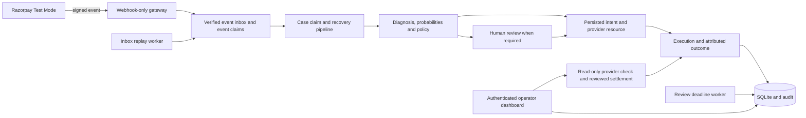

# RecoverAI — Payment Recovery & Reconciliation

[](https://github.com/Sneha-090/RecoverAI/actions/workflows/tests.yml)

RecoverAI is a payment-recovery application, currently verified in Razorpay **Test Mode**, combining FastAPI, SQLAlchemy,
Streamlit, logistic regression and deterministic recovery policies. It handles
failed-payment events, selects an intervention, requests human review when
required, and verifies the result against the original recovery execution.

Its strongest evidence is the recovery workflow and failure handling. It is not
a production merchant deployment, an LLM assistant, or proof of revenue uplift.

The next target is a supervised single-merchant pilot for an online-course or
adult skill-training business. See the [pilot plan](PILOT_PLAN.md) for the
recommended scope, remaining collection-safety gaps and success measurements.

## Evidence you can reproduce

| Evidence | What it establishes | What it does not establish |
| --- | --- | --- |
| [Matched policy benchmark](reports/POLICY_BENCHMARK.md) | Policy comparison on identical held-out synthetic contexts, costs and outcome labels | Real merchant ROI or ML superiority |
| [Offline walkthrough](reports/OFFLINE_DEMO.md) / [interactive replay](reports/offline_demo.html) | Real service behavior under six controlled scenarios with a fake provider | A new live provider test |
| [Razorpay verification record](TEST_MODE_VERIFICATION.md) | Two historical hosted Test Mode recovery walkthroughs, plus API/configuration checks | Real-money recovery or production readiness |
| Automated tests and CI | Regression coverage for authentication, concurrency, eligibility and recovery state | Complete correctness under every production failure |

### Benchmark result, including the limitation

Five predefined grouped train/test splits compare guarded blanket retry,
cause-based rules, ML value ranking, and the actual guarded ML selector. Every
policy sees the same held-out contexts, fixed synthetic outcomes, costs and
one-intervention budget. Outcomes are **not** sampled from the model being
scored. The model is fitted on the training groups only.

On the primary 400-context split, ML value ranking's net difference against
cause rules is **Rs.-735.83**, with a paired bootstrap interval of
**[Rs.-12,971.92, Rs.13,456.14]**. This does not establish a clear ML advantage.
Guarded ML defers some cases to review; these results measure immediate automatic
recovery, not recovery after a human decision. Reviewer labor is not modeled.

See the report for all split results, assumptions, source/data hashes and
[case-level decisions](reports/policy_decisions.csv). Repeated split test sets
overlap across runs; their counts must not be pooled as independent customers.
The separate classifier evaluation is in [ML/evaluation.json](ML/evaluation.json).

## Run the isolated demo first — no credentials required

From the existing Windows installation:

```bat
cd /d D:\RecoverAI
.venv\Scripts\python.exe -m scripts.offline_demo
.venv\Scripts\python.exe -m ML.benchmark_policies
```

Open `reports/offline_demo.html` for the recorded interactive replay. Its buttons
replay measured trace steps; they do not run backend requests. Regenerate the
report with the command above to exercise the services again.

The demo replaces credentials **in its own process**, creates a new database
under `.venv/demo_runs`, uses a fake SDK provider, and blocks external HTTP and
socket connections. Windows loopback IPC is allowed for asyncio. It does not
read/write the configured merchant database or change `.env`. Existing run
files are not reused or deleted. `scripts.live_demo` is now a safe alias for
this offline walkthrough; it no longer makes real provider calls.

The six scenarios are:

1. Signed failure, duplicate rejection, pending payment and verified capture.
2. High-value recovery requiring explicit human approval.
3. Lost creation response, followed by verified reconciliation without another creation.
4. A late successful capture attributed to an older retry.
5. Review expiry without an automatically authorized payment action.
6. A capture arriving before execution persistence, then handled by inbox replay.

## Local architecture



See [ARCHITECTURE.md](ARCHITECTURE.md) for concrete modules and state transitions.

## Fresh Windows setup

Use Python 3.13 and keep the project, environment and temporary files on D when
C space is limited. The existing D installation does not need to be downloaded
again. For a fresh clone/environment:

```bat
git clone https://github.com/Sneha-090/RecoverAI.git D:\RecoverAI
cd /d D:\RecoverAI
python -m venv .venv
mkdir .venv\tmp
set TEMP=%CD%\.venv\tmp
set TMP=%TEMP%
.venv\Scripts\python.exe -m pip install --no-cache-dir -r requirements-dev.txt
```

`requirements.txt` installs the hash-checked runtime lock; `requirements-dev.txt`
adds the locked test tools. The supported interpreter is Python 3.13. Universal
resolution records platform markers and distribution hashes; Windows local checks
and Linux CI validate the supported platforms. No implicit package upgrade occurs
at install. Source requirements are in `requirements.in`/`requirements-dev.in`.

To deliberately regenerate a lock, install `uv==0.13.7` in the D drive environment,
set `UV_CACHE_DIR=%CD%\.venv\uv-cache` and `UV_PYTHON_DOWNLOADS=never`, then run
`uv pip compile requirements.in --universal --python-version 3.13 --generate-hashes --output-file requirements.lock`
and the equivalent command for `requirements-dev.in`. Review/test the resulting
version changes before deployment. The initial locks preserve the working local
versions; a lock controls dependency resolution, not application correctness.

## Configure actual Razorpay Test Mode operation

Offline demo and benchmark commands do not require this configuration. For the
actual application, copy `.env.example` to `.env` and configure locally:

- `RAZORPAY_KEY_ID`, `RAZORPAY_KEY_SECRET`, `RAZORPAY_WEBHOOK_SECRET`: Test Mode values.
- `OPERATOR_USERNAME`: your local operator username.
- `API_BASE_URL=http://127.0.0.1:8001` for the backend command below.
- `DATABASE_URL=sqlite:///./recoverai.db` unless a different local DB is intended.

Never commit `.env`, share credentials in chat, or expose the operator backend
through the webhook tunnel. Set/reset the operator password locally:

```bat
.venv\Scripts\python.exe -m scripts.reset_operator_password
.venv\Scripts\python.exe -m app.db.init_db
```

Enter a matching password of 12–1024 characters. Typing stays hidden. The helper
prints neither password nor hash and preserves other `.env` values. Restart
operator processes after changing credentials so the new hash is loaded.
`python -m scripts.hash_password` remains available for manual hash generation.

Database setup now uses reviewed Alembic revisions. Stop app/workers first. A
fresh database uses `init_db`; an existing unversioned SQLite database requires
`python -m app.db.init_db --adopt-legacy`. Adoption validates the frozen baseline,
checks references and creates a verified backup under `var/backups` before
stamping/upgrading. Differing/unknown schemas stop for review. See
[migration operations](migrations/README.md). Internal `/ready` returns 503 when
the schema, operator setup or model artifact is not ready; `/health` is liveness.

### Start the supervised local application

```bat
.venv\Scripts\python.exe -m scripts.run_local --check
.venv\Scripts\python.exe -m scripts.run_local
```

This starts the API, dashboard, webhook gateway and three workers, with bounded
restarts and owned-process shutdown. Use `--status` or `--stop` from another
terminal. Stop old manual processes first. See [operations](OPERATIONS.md) for
monitoring limits, shutdown and maintenance steps.

### Manual alternative: separate terminals

From the activated D drive environment:

```bat
.venv\Scripts\activate
python -m uvicorn app.main:app --host 127.0.0.1 --port 8001
```

```bat
python -m uvicorn app.webhook_gateway:app --host 127.0.0.1 --port 8002
```

```bat
streamlit run dashboard.py --server.address 127.0.0.1 --server.port 8501
```

```bat
python -m scripts.replay_webhooks --watch --interval 15
```

```bat
python -m scripts.maintain_reviews --watch --interval 60
```

Sign in at [the local dashboard](http://127.0.0.1:8501). All workers must share the
same configuration/database. They run only while their process is alive; these
commands do not register OS startup services.

Only port **8002** is a public webhook tunnel target. It exposes signed
`POST /webhooks/razorpay` and excludes checkout, operator APIs, docs and config
paths. Register the matching Test Mode webhook secret and supported
`payment.failed`/`payment.captured` events in Razorpay. The operator API,
authenticated checkout and dashboard remain local/private.

## Failure-handling contract

- **Duplicates/concurrency:** database event claims and per-case reservations
  prevent competing operations from starting overlapping recovery work.
- **Intent before creation:** a durable recovery intent is referenced in provider
  notes before the external request. Losing the response does not authorize a retry.
- **Early events:** verified minimal correlation data stays in a durable inbox
  until its execution can be matched. Replay backs off and retains unresolved
  events for reconciliation after 20 processing attempts.
- **Exact attribution:** provider IDs bind to an execution, with one attributed
  result. A verified late success can upgrade its earlier failed result and
  recover the original case without changing a newer execution's outcome.
- **Amounts:** provider requests and stored expectations share exact integer
  paise conversion. Rs.19.90 is 1,990 paise; invalid/fractional paise are rejected.
- **Human review:** approvals cannot repeat an executed action type. Review
  recommendations do not consume executed-retry budgets or cooling-off time.
- **Expiry:** overdue reviews, case closure, audit and claim cleanup commit
  together. Active/uncertain provider operations are not reset on a timeout.
- **Reconciliation:** the Recovery Review tab can verify an existing resource
  and settle a blocked case after a fresh check. It never creates a new payment
  resource or forces uncertain webhook replay. Ambiguous history stays blocked.

Useful local checks:

```bat
python -m scripts.inspect_reservations
python -m scripts.replay_webhooks --list
python -m scripts.replay_webhooks --event-id EVENT_ID
python -m scripts.maintain_reviews --limit 100
```

A selected-event retry does not bypass processing, completed or reconciliation
claims. The review screen shows held events without raw customer payloads.

## Tests and CI

```bat
python -m pytest -q
```

Tests use dummy credentials and isolated databases. CI runs regression tests,
refits the held-out classifier evaluation, reproduces the matched benchmark,
and executes the isolated demo. Test/evaluation/demo artifacts are uploaded.
Local passing tests and remote CI results are distinct; inspect the linked run.

## What remains limited

- ML data and policy outcomes are synthetic. Verified provider customer IDs now
  link observed history when present; the current Test Mode examples have no
  linked finalized customer history. Merchant performance remains unvalidated.
- `retry` creates a new order requiring checkout; it is not an automatic charge.
  `alt_method` uses a hosted link with the failed method hidden and verifies
  the captured alternate method; account configuration determines availability.
- Successful recovery stops local follow-up but does not automatically cancel
  other provider resources. Processing crashes, unknown legacy references and
  exhausted/ambiguous events still require operational investigation.
- Pending-outcome polling and reviewed unpaid-link cleanup are implemented.
  Supervised worker restarts, dependency locks, versioned migrations,
  multi-operator roles and public deployment controls remain.
- Real merchant adoption, permissions and measured business outcomes require a
  separate pilot. No production revenue claim is supported by these artifacts.

The completed prototype/evidence scope and remaining priorities are tracked in
[ROADMAP.md](ROADMAP.md). Interview preparation should use this implementation
and these measured limitations, rather than invented impact figures.


### Failure diagnosis and model coverage

Recovery uses explicit provider reasons; generic `payment_failed`, broad error
codes, missing reasons and unrecognised reasons remain `unclassified_error`.
The saved model's fitted action-interaction categories define supported causes.
Unsupported causes enter **Human Review** as `manual_assessment`, with no model
probabilities, preferred action or automatic provider resource. The operator must
select an action explicitly; existing eligibility and duplicate-execution guards
still apply. Recommendations do not count as executed attempts in ML features.
The synthetic benchmark covers its four trained causes; it does not evaluate
unknown-cause review outcomes or real merchant effectiveness. Offline automatic
walkthrough scenarios use the explicit `payment_declined` fixture reason.
Historical recorded diagnoses and outcomes are retained; this policy applies to
new decisions and does not rewrite recovered cases.


### Inspecting action preference

Dashboard headline totals now cover **Razorpay Test Mode** records only. The
**Action Distribution** tab separates Test Mode from simulation and filters by
recorded diagnosis. It distinguishes each case's first recorded decision from
executed actions and human-approved executions, includes pending manual
assessments, and shows the denominator and unprocessed cases. Cause-wise counts
help inspect case mix; unequal action shares are not evidence of bias or causal
effectiveness. The tab is descriptive, and does not combine synthetic evidence
with provider Test Mode records or present Test Mode money as merchant revenue.


### Distinct checkout actions

`retry` creates a fresh order opened through the authenticated operator Test Mode
checkout; it never automatically debits a card. `payment_link` creates an ordinary
hosted link. `alt_method` creates a link whose documented checkout method options
hide the original failed method (card, UPI, netbanking or wallet). Missing or
unsupported original methods make `alt_method` ineligible, including at approval.
New alternate-method recoveries verify a captured payment used an allowed different
method before settlement. Lost responses preserve this policy in provider intent
notes, so reviewed reconciliation performs the same check. Existing legacy
executions retain their recorded semantics. Checkout availability still depends
on merchant/account configuration; display customisation is not a payment-network
restriction. SMS/email notifications and provider reminders are disabled.

API reference: https://tfs.np.razorpay.in/docs/api/payments/payment-links/customise-payment-methods


### Review policy and probability meaning

Estimated recovery probability is not confidence in choosing the best action.
The former 40-60% probability band has been replaced by `MIN_ACTION_MARGIN_RATIO`
(default `0.02`): review is requested when the top two eligible cost-adjusted
values differ by no more than 2% of the payment amount. This is a configurable,
predeclared business rule, not an empirically established confidence interval.
High-value and unsupported-cause reviews still apply. The matched benchmark uses
the same selector and reports reviews as unresolved; it assumes supported
original payment methods, which its synthetic table does not record.


### Verified customer history

Ingestion links only the provider's validated `cust_` identifier; contact details
are not used to infer identity. Changed customer ownership is rejected. Model
history is derived from other finalized cases with observed success or audited
closure evidence available at decision time; current, pending, future and other
customers' cases are excluded. Duplicate outcomes never duplicate cases. Missing
history uses an explicit 50% neutral assumption. New decision explanations record
the exact numeric/history feature snapshot; legacy customer counters are not
silently treated as observed outcomes. No real customer history is fabricated.


### Training selection and input coverage

The training command compares four predeclared candidates (three regularized
logistic models and a random forest) on an inner grouped validation split,
selects by validation log loss/Brier score, then refits on the outer training
partition. The outer test groups do not select the winner. Each policy benchmark
split repeats this same procedure. Reports include candidate scores, per-action
and per-cause evaluation, calibration-bin sample counts and numeric training
ranges. Values outside the saved model's training ranges require manual
assessment, without fabricated extrapolation probabilities.

This improves the evaluation procedure, not a claim of production effectiveness.
The existing synthetic test set has been inspected in earlier project audits;
a new blind merchant validation set is still required. Missing failure categories
remain unsupported until justified training outcomes exist; no real data is
invented to fill them.


### Operator case navigation

Live cases support literal payment-ID search and case-status filtering, capped at
200 newest results. Headline totals still describe the entire Test Mode source.
Decision Explanation includes a bounded chronological activity timeline with
readable event names and validated provider references. Raw webhook payloads,
contact details and unstructured exception text are never rendered in that view.


### Pending payment follow-up

Run `.venv\Scripts\python.exe -m scripts.poll_outcomes --watch` in a separate
terminal. Each batch checks at most 25 due `awaiting_outcome` Test Mode cases,
with a 60-second per-case cooling period. It uses the same exclusive claim and
verified execution attribution as webhooks. Paid cases settle once; unpaid cases
stay pending; terminal failed attempts follow the normal guarded policy. Active,
review and reconciliation claims are never taken over. Provider errors remain
blocked for review. Provider requests have 5-second connect / 20-second read
socket timeouts; no SMS/email notifications are sent by this worker. The worker
must stay running; operating-system supervision is not configured here.


### Old recovery checkouts

Decision Explanation provides separate **Check old link status** and **Cancel
unpaid old link** controls for closed cases. Cleanup validates the recorded
execution's ownership, provider ID, amount, currency and current unpaid state
under the exclusive case claim; it works only with Test Mode credentials. Every
cancel attempt re-fetches provider state, including after a lost response. Paid,
partially-paid, active-case, order and mismatched resources cannot be cancelled
through this control. No refund or replacement checkout is created. The private
retry checkout rejects closed/inactive recovery orders; orders themselves are not
cancelled at the provider. There is no claim that all external payment races can
be prevented; a merchant pilot still needs duplicate-charge investigation.

Provider cancellation reference: https://razorpay.com/docs/api/payments/payment-links/cancel-standard/


Partial or inconsistent paid amounts block further collection for reconciliation,
including expired/cancelled legacy links. New links explicitly disable partial
payments. The system does not automatically collect the full original amount
again after observing a partial payment, or issue refunds.
