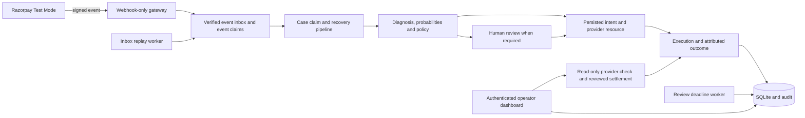

# RecoverAI — Payment Recovery & Reconciliation Prototype

[](https://github.com/Sneha-090/RecoverAI/actions/workflows/tests.yml)

RecoverAI is a Razorpay **Test Mode** prototype combining FastAPI, SQLAlchemy,
Streamlit, logistic regression and deterministic recovery policies. It handles
failed-payment events, selects an intervention, requests human review when
required, and verifies the result against the original recovery execution.

Its strongest evidence is the recovery workflow and failure handling. It is not
a production merchant deployment, an LLM assistant, or proof of revenue uplift.

## Evidence you can reproduce

| Evidence | What it establishes | What it does not establish |
| --- | --- | --- |
| [Matched policy benchmark](reports/POLICY_BENCHMARK.md) | Policy comparison on identical held-out synthetic contexts, costs and outcome labels | Real merchant ROI or ML superiority |
| [Offline walkthrough](reports/OFFLINE_DEMO.md) / [interactive replay](reports/offline_demo.html) | Real service behavior under six controlled scenarios with a fake provider | A new live provider test |
| [Razorpay verification record](TEST_MODE_VERIFICATION.md) | One actual hosted Test Mode failure-to-recovery checkout, plus later local checks | Real-money recovery or production readiness |
| Automated tests and CI | Regression coverage for authentication, concurrency, eligibility and recovery state | Complete correctness under every production failure |

### Benchmark result, including the limitation

Five predefined grouped train/test splits compare guarded blanket retry,
cause-based rules, ML value ranking, and the actual guarded ML selector. Every
policy sees the same held-out contexts, fixed synthetic outcomes, costs and
one-intervention budget. Outcomes are **not** sampled from the model being
scored. The model is fitted on the training groups only.

On the primary 400-context split, ML value ranking's net difference against
cause rules is **Rs.-735.83**, with a paired bootstrap interval of
**[Rs.-12,971.92, Rs.13,456.14]**. This does not establish a clear ML advantage.
Guarded ML defers some cases to review; these results measure immediate automatic
recovery, not recovery after a human decision. Reviewer labor is not modeled.

See the report for all split results, assumptions, source/data hashes and
[case-level decisions](reports/policy_decisions.csv). Repeated split test sets
overlap across runs; their counts must not be pooled as independent customers.
The separate classifier evaluation is in [ML/evaluation.json](ML/evaluation.json).

## Run the isolated demo first — no credentials required

From the existing Windows installation:

```bat
cd /d D:\RecoverAI
.venv\Scripts\python.exe -m scripts.offline_demo
.venv\Scripts\python.exe -m ML.benchmark_policies
```

Open `reports/offline_demo.html` for the recorded interactive replay. Its buttons
replay measured trace steps; they do not run backend requests. Regenerate the
report with the command above to exercise the services again.

The demo replaces credentials **in its own process**, creates a new database
under `.venv/demo_runs`, uses a fake SDK provider, and blocks external HTTP and
socket connections. Windows loopback IPC is allowed for asyncio. It does not
read/write the configured merchant database or change `.env`. Existing run
files are not reused or deleted. `scripts.live_demo` is now a safe alias for
this offline walkthrough; it no longer makes real provider calls.

The six scenarios are:

1. Signed failure, duplicate rejection, pending payment and verified capture.
2. High-value recovery requiring explicit human approval.
3. Lost creation response, followed by verified reconciliation without another creation.
4. A late successful capture attributed to an older retry.
5. Review expiry without an automatically authorized payment action.
6. A capture arriving before execution persistence, then handled by inbox replay.

## Local architecture



See [ARCHITECTURE.md](ARCHITECTURE.md) for concrete modules and state transitions.

## Fresh Windows setup

Use Python 3.13 and keep the project, environment and temporary files on D when
C space is limited. The existing D installation does not need to be downloaded
again. For a fresh clone/environment:

```bat
git clone https://github.com/Sneha-090/RecoverAI.git D:\RecoverAI
cd /d D:\RecoverAI
python -m venv .venv
mkdir .venv\tmp
set TEMP=%CD%\.venv\tmp
set TMP=%TEMP%
.venv\Scripts\python.exe -m pip install --no-cache-dir -r requirements.txt
```

Dependencies other than scikit-learn are not fully locked yet; the CI badge and
verification record identify actual tested runs rather than guaranteeing every
future dependency combination.

## Configure actual Razorpay Test Mode operation

Offline demo and benchmark commands do not require this configuration. For the
actual application, copy `.env.example` to `.env` and configure locally:

- `RAZORPAY_KEY_ID`, `RAZORPAY_KEY_SECRET`, `RAZORPAY_WEBHOOK_SECRET`: Test Mode values.
- `OPERATOR_USERNAME`: your local operator username.
- `API_BASE_URL=http://127.0.0.1:8001` for the backend command below.
- `DATABASE_URL=sqlite:///./recoverai.db` unless a different local DB is intended.

Never commit `.env`, share credentials in chat, or expose the operator backend
through the webhook tunnel. Set/reset the operator password locally:

```bat
.venv\Scripts\python.exe -m scripts.reset_operator_password
.venv\Scripts\python.exe -m app.db.init_db
```

Enter a matching password of 12–1024 characters. Typing stays hidden. The helper
prints neither password nor hash and preserves other `.env` values. Restart
operator processes after changing credentials so the new hash is loaded.
`python -m scripts.hash_password` remains available for manual hash generation.

For an existing installation, stop app/workers before running `init_db`, then
restart them. Initialization adds missing tables; it is not a migration system
for arbitrary future schema alterations.

### Run local processes in separate terminals

From the activated D drive environment:

```bat
.venv\Scripts\activate
python -m uvicorn app.main:app --host 127.0.0.1 --port 8001
```

```bat
python -m uvicorn app.webhook_gateway:app --host 127.0.0.1 --port 8002
```

```bat
streamlit run dashboard.py --server.address 127.0.0.1 --server.port 8501
```

```bat
python -m scripts.replay_webhooks --watch --interval 15
```

```bat
python -m scripts.maintain_reviews --watch --interval 60
```

Sign in at [the local dashboard](http://127.0.0.1:8501). All workers must share the
same configuration/database. They run only while their process is alive; these
commands do not register OS startup services.

Only port **8002** is a public webhook tunnel target. It exposes signed
`POST /webhooks/razorpay` and excludes checkout, operator APIs, docs and config
paths. Register the matching Test Mode webhook secret and supported
`payment.failed`/`payment.captured` events in Razorpay. The operator API,
authenticated checkout and dashboard remain local/private.

## Failure-handling contract

- **Duplicates/concurrency:** database event claims and per-case reservations
  prevent competing operations from starting overlapping recovery work.
- **Intent before creation:** a durable recovery intent is referenced in provider
  notes before the external request. Losing the response does not authorize a retry.
- **Early events:** verified minimal correlation data stays in a durable inbox
  until its execution can be matched. Replay backs off and retains unresolved
  events for reconciliation after 20 processing attempts.
- **Exact attribution:** provider IDs bind to an execution, with one attributed
  result. A verified late success can upgrade its earlier failed result and
  recover the original case without changing a newer execution's outcome.
- **Amounts:** provider requests and stored expectations share exact integer
  paise conversion. Rs.19.90 is 1,990 paise; invalid/fractional paise are rejected.
- **Human review:** approvals cannot repeat an executed action type. Review
  recommendations do not consume executed-retry budgets or cooling-off time.
- **Expiry:** overdue reviews, case closure, audit and claim cleanup commit
  together. Active/uncertain provider operations are not reset on a timeout.
- **Reconciliation:** the Recovery Review tab can verify an existing resource
  and settle a blocked case after a fresh check. It never creates a new payment
  resource or forces uncertain webhook replay. Ambiguous history stays blocked.

Useful local checks:

```bat
python -m scripts.inspect_reservations
python -m scripts.replay_webhooks --list
python -m scripts.replay_webhooks --event-id EVENT_ID
python -m scripts.maintain_reviews --limit 100
```

A selected-event retry does not bypass processing, completed or reconciliation
claims. The review screen shows held events without raw customer payloads.

## Tests and CI

```bat
python -m pytest -q
```

Tests use dummy credentials and isolated databases. CI runs regression tests,
refits the held-out classifier evaluation, reproduces the matched benchmark,
and executes the isolated demo. Test/evaluation/demo artifacts are uploaded.
Local passing tests and remote CI results are distinct; inspect the linked run.

## What remains limited

- ML data and policy outcomes are synthetic; live ingestion does not populate
  the customer-history features needed to validate real merchant performance.
- `retry` creates a new order requiring checkout; it is not an automatic charge.
  `payment_link` and `alt_method` currently both create links, not distinct rails.
- Successful recovery stops local follow-up but does not automatically cancel
  other provider resources. Processing crashes, unknown legacy references and
  exhausted/ambiguous events still require operational investigation.
- Periodic pending-outcome polling, supervised worker restarts, dependency locks,
  versioned migrations, multi-operator roles and public deployment controls remain.
- Real merchant adoption, permissions and measured business outcomes require a
  separate pilot. No production revenue claim is supported by these artifacts.

The completed prototype/evidence scope and remaining priorities are tracked in
[ROADMAP.md](ROADMAP.md). Interview preparation should use this implementation
and these measured limitations, rather than invented impact figures.
