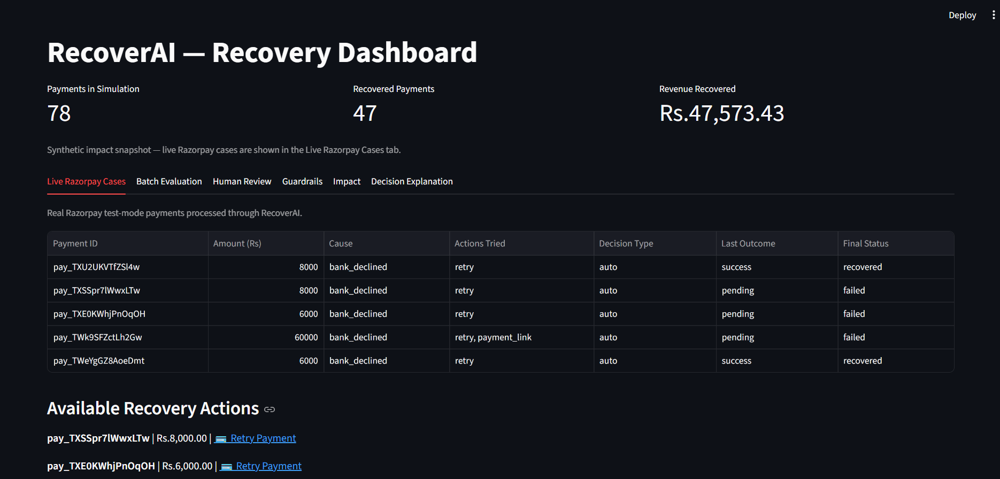
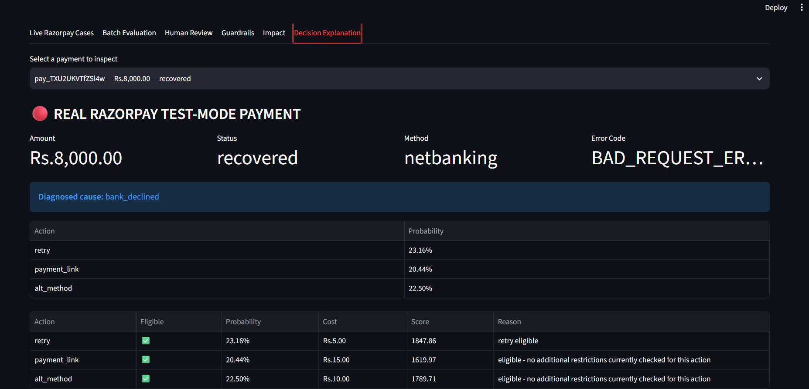
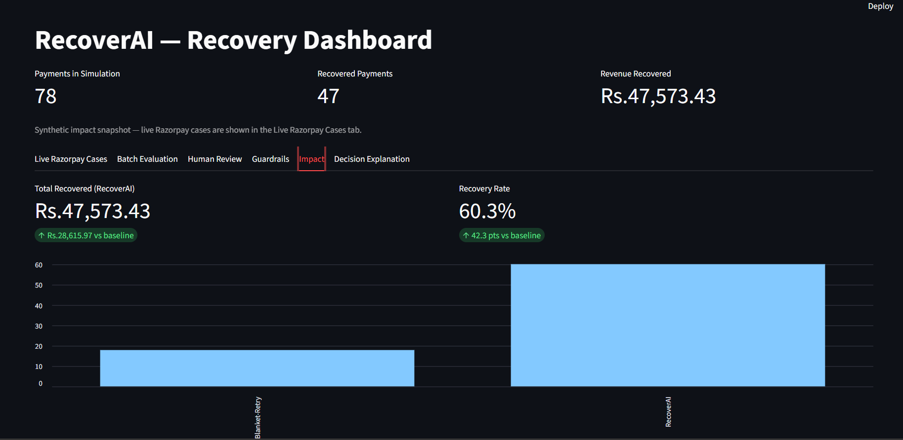

# RecoverAI — AI-Assisted Revenue Recovery Agent

[](https://github.com/Sneha-090/RecoverAI/actions/workflows/tests.yml)

See [the verified status and improvement plan](ROADMAP.md) for remaining gaps,
priorities, acceptance criteria, and evidence-backed resume claims.

RecoverAI is an AI-assisted revenue recovery system for failed Razorpay payments.

Instead of treating every failed payment with the same retry strategy, RecoverAI:

- Detects failed payments through Razorpay webhooks
- Diagnoses the likely failure cause
- Uses ML predictions to estimate recovery probability
- Applies eligibility rules and business guardrails
- Scores available recovery actions
- Automatically executes selected low-risk actions
- Escalates selected cases for human approval
- Verifies real Razorpay recovery outcomes
- Re-scores remaining recovery options after an unsuccessful recovery attempt
- Records decisions, actions, outcomes, and webhook events for auditability

> **Goal:** Recover more payment revenue while avoiding unnecessary retries and unsafe automated actions.

---

## Track 03 — AI Revenue Recovery

RecoverAI was built for **Track 03: AI Revenue Recovery — Find revenue that's slipping away and win it back.**

The project focuses on the **payment degradation → root cause → recovery action** direction.

The central idea is that a failed payment should not automatically result in another blind retry.

Instead, RecoverAI asks:

```text
Why did the payment fail?
        ↓
Is recovery worth attempting?
        ↓
Which intervention has the best expected recovery value?
        ↓
Should the action happen automatically or require approval?
        ↓
Did the recovery actually work?
        ↓
How much revenue was recovered?
```

---

## Problem

Payment failures create direct revenue leakage.

Not every failed payment should be handled in the same way:

- Some failures are worth retrying
- Some are better handled using a payment link
- Some may be better handled using an alternate payment method
- High-value or uncertain cases may require human approval

RecoverAI approaches payment recovery as a **decision problem**, rather than simply retrying every failed payment.

---

## What RecoverAI Solves

RecoverAI closes the loop from **payment failure detection to verified recovery**.

The system does not stop at identifying a failed payment.

It:

1. Detects the failure
2. Diagnoses the likely cause
3. Estimates recovery probability for available actions
4. Checks eligibility and safety guardrails
5. Chooses an action using cost-aware scoring
6. Executes or escalates the action
7. Observes the real Razorpay outcome
8. Re-evaluates remaining options after unsuccessful attempts
9. Records the entire decision and outcome trail

This makes the recovery process measurable, controlled, and outcome-aware.

---

## How RecoverAI Works

```text
Razorpay Payment
       |
       | payment.failed
       v
Razorpay Webhook
       |
       v
Payment Ingestion
       |
       v
Failure Diagnosis
       |
       v
ML Recovery Prediction
       |
       v
Eligibility + Guardrails
       |
       v
Cost-Aware Action Scoring
       |
       v
Decision
   /       |       \
AUTO     HUMAN      SKIP
          REVIEW
  |         |
  v         v
       Recovery Action
            |
            v
Razorpay Recovery Order / Payment Link
            |
            v
Customer Retry / Payment
            |
            | payment.captured / recovery failure
            v
Outcome Verification
            |
            v
Recovered / Next Action / Closed
```

---

## Recovery Actions

RecoverAI currently supports three recovery actions:

- `retry`
- `payment_link`
- `alt_method`

The final decision can be:

- **Auto** — execute the selected recovery action automatically
- **Human Review** — require business-user approval
- **Skip** — do not attempt recovery

The system re-evaluates remaining eligible actions after an unsuccessful recovery attempt while excluding actions that have already been tried.

---

## AI / ML Decision Making

RecoverAI uses ML to estimate the probability that a particular recovery action will succeed.

The model predicts recovery probability for each candidate action rather than directly deciding whether money should be recovered.

The final decision combines the ML prediction with deterministic business rules.

```text
ML Recovery Probability
          +
Eligibility
          +
Business Guardrails
          +
Recovery Cost
          +
Action Scoring
          +
Human-Review Policy
          |
          v
      Final Decision
```

This separation is intentional:

- **ML** is used where prediction is useful.
- **Deterministic rules** control safety-sensitive behaviour such as retry limits, recovery windows, high-value escalation, approval requirements, and duplicate prevention.

---

## Cost-Aware Action Scoring

For an eligible action, RecoverAI calculates an expected-value style score:

```text
Recovery Score
= P(action succeeds) × payment amount − action cost
```

The system then considers eligibility, previous attempts, guardrails, and review policy before selecting the final action.

This makes the system optimize for **expected recoverable value**, rather than simply selecting the action with the highest raw ML probability.

---

## Safety-First Automation

RecoverAI does not allow the ML model to operate without constraints.

Every recovery action first passes a case-wide eligibility check. Cases with
`captured`, `authorized`, `recovered`, or `closed_unrecovered` status (or provider
state) are skipped before ML prediction or action scoring. The recovery window
expires exactly `max_recovery_window_days` after the payment creation time;
this applies to retries, payment links, alternate methods, and human approvals.
Missing creation times also block recovery. Blocked executions record a reason
in the audit log without creating an order or link.

Payment ingestion uses Razorpay's creation timestamp when supplied, so importing
an old payment does not restart its recovery window. Re-fetching the original
charge preserves a case's `recovered` or `closed_unrecovered` status. Retry-only
restrictions, such as the `halted` state, still allow eligible customer-assisted
recovery through a payment link or alternate method.

Examples of bounded policies include:

```text
Maximum retry attempts
Retry cooling-off period
Maximum recovery window
Human-review confidence band
High-value review threshold
Approval deadline
Non-retryable payment states
Duplicate-attempt prevention
```

This keeps automated recovery within explicit operational boundaries.

---

## Live Razorpay Integration

RecoverAI uses **Razorpay Test Mode** to demonstrate a real payment recovery workflow.

### Failed Payment Flow

```text
Customer Payment Attempt
        |
        v
Payment Fails
        |
        v
Razorpay sends payment.failed
        |
        v
RecoverAI Webhook
        |
        v
Payment Ingestion
        |
        v
Diagnosis + ML Prediction
        |
        v
Eligibility + Guardrails
        |
        v
Decision
        |
        v
Recovery Action
```

The webhook validates Razorpay's webhook signature before processing the event.

RecoverAI also uses Razorpay's event ID to prevent duplicate webhook processing. Processed webhook event IDs are stored in the audit log and protected by a database uniqueness constraint.

---

## Webhook Reliability and Idempotency

Webhook processing now reserves each event ID in `webhook_receipts` **before**
ingestion or execution. Concurrent deliveries cannot both reserve the same ID.
Handled events require `X-Razorpay-Event-Id`; a completed delivery is acknowledged
without executing again. In-flight duplicates return HTTP 503 for later retry.
An interrupted delivery is marked `needs_reconciliation` and is not automatically
replayed, because the external provider may already have accepted an action.

After updating an existing installation, stop the app, run
`python -m app.db.init_db`, then restart it. This adds the reservation and
execution-attribution tables without removing existing data. Existing audit-log
event IDs remain recognized. New automatic and human-approved executions store
their action, audit entry, provider resource ID, amount in paise, and currency
in `recovery_executions` for precise outcome correlation.
`recovery_intents` is saved before contacting Razorpay; its reference is included
in provider notes and bound to the execution after the response is persisted.
If the response is lost, the intent remains available for reconciliation.

`recovery_reservations` also permits only one active operation per payment,
including checkout-triggered processing, webhook execution, human approvals,
and outcome observation. Reservations remain while an order/link awaits payment
or a case awaits human review. Outcome observation and approval atomically take
over their corresponding waiting phase. Unpaid/open orders and links remain
pending; they do not trigger another recovery action. Delayed events resolve the
exact execution: an older verified success settles the case, while an older
failure cannot advance the current attempt. Captures must match the stored
amount/currency, and each execution has one attributed outcome. A later success
updates its earlier failed result. Pending reviews are expired after recovery;
previously issued provider links/orders are not automatically cancelled.
A busy outcome webhook returns 503
and remains retryable, so it can be handled after the owner finishes.

If a provider request times out, or saving its result fails, the reservation is
retained as `needs_reconciliation`. A process crash can leave `processing`.
Neither state expires automatically: retrying blindly could create a second
order/link. Run `python -m scripts.inspect_reservations` for a read-only list.
An operator must check Razorpay and reconcile action/audit records before
releasing interrupted reservations. Automatic provider reconciliation and a
background worker are not implemented; no exactly-once provider guarantee is
claimed. Existing unobserved actions and pending reviews are recognized when
upgrading, so installing the new tables does not reopen them for execution.

RecoverAI handles:

```text
payment.failed
payment.captured
```

Each incoming webhook is checked using the Razorpay event ID:

```text
X-Razorpay-Event-Id
        |
        v
Duplicate Event Check
        |
   +----+----+
   |         |
  New     Duplicate
   |         |
   v         v
Process    Ignore
```

This prevents the same Razorpay event from triggering duplicate recovery processing.

The webhook endpoint also retains additional payment/action-level safeguards for recently processed recovery attempts.

Recovery-related webhook events are correlated with the original recovery case so that a recovery payment is treated as an outcome of the existing case rather than as an unrelated new payment.

---

## Live Recovery Verification

The current prototype demonstrates the complete closed-loop recovery flow for the **retry** strategy:

```text
Original Payment
       |
       v
FAILED
       |
       v
payment.failed webhook
       |
       v
RecoverAI decides retry
       |
       v
RecoverAI creates Recovery Order
       |
       v
Customer completes retry payment
       |
       v
payment.captured webhook
       |
       v
RecoverAI verifies the real Razorpay state
       |
       v
Original Case = RECOVERED
```

This is intentionally designed so that RecoverAI does **not** assume that creating a recovery order means the payment succeeded.

Recovery is marked successful only after the actual Razorpay payment outcome is observed and verified.

Payment-link and alternate-method recovery actions are implemented in the recovery layer, including outcome-verification logic. The primary live demonstration focuses on the retry path because it is the most directly demonstrated Razorpay Test Mode flow.

---
## Dashboard Preview

### Recovery Dashboard



### Decision Explanation



### Measured Recovery Impact



## Dashboard

RecoverAI provides a Streamlit dashboard with the following sections.

### Top-Level Recovery Snapshot

The dashboard displays a top-level synthetic impact snapshot containing:

- Payments in simulation
- Recovered payments
- Revenue recovered

The snapshot is clearly labeled as synthetic evaluation data. Live Razorpay payment cases are shown separately.

### Live Razorpay Cases

Displays real Razorpay Test Mode payment cases including:

- Payment ID
- Amount
- Diagnosed cause
- Actions attempted
- Decision type
- Latest outcome
- Final status

For retry-based recoveries, the dashboard provides a **Retry Payment** link for the generated recovery order.

### Batch Evaluation

Evaluates the recovery decision logic against synthetic payment data and displays:

- Total cases
- Recovered cases
- Recovery rate

The batch evaluation uses real decision logic while the simulated outcomes are explicitly identified as synthetic.

### Human Review

Allows a business user to:

- Inspect the ML recommendation
- Understand why a case was escalated
- Choose a recovery action
- Approve and execute the action

Human-approved actions are recorded and included in recovery outcome tracking.

### Guardrails

Displays safety policies such as:

- Maximum retry attempts
- Retry cooling-off period
- Maximum recovery window
- Human-review confidence band
- High-value review threshold
- Approval deadline
- Non-retryable Razorpay states
- Duplicate-attempt prevention

### Impact

Compares RecoverAI's recovery metrics against a naive blanket-retry baseline using the project's synthetic evaluation data.

The dashboard shows:

- Total recovered revenue
- Recovery rate
- Difference versus baseline
- Recovery-rate comparison chart

### Decision Explanation

Shows case-level information including:

- Diagnosis
- ML probabilities
- Recovery scores
- Selected action
- Decision type
- Decision reason
- Observed outcomes
- Final payment status

Payments can be selected from a dropdown for easier live demonstration.

---

## Measured Recovery

The Track 03 requirement is not only to identify revenue at risk, but to demonstrate **measured recovery**.

RecoverAI therefore tracks:

```text
Payment Amount
      ↓
Recovery Attempts
      ↓
Recovery Outcome
      ↓
Recovered Payment
      ↓
Recovered Revenue
```

The dashboard's synthetic batch evaluation reports recovery metrics and compares them with a naive blanket-retry baseline.

### Evaluation Snapshot

Replace the placeholders below with the final values from the evaluation run before submission.

### Evaluation Snapshot

| Metric | Value |
|---|---:|
| Payments evaluated | 78 |
| Recovered payments | 47 |
| Revenue recovered | ₹47,573.43 |
| Recovery rate | 60.3% |
| Baseline recovery rate | 18.0% |
| Improvement vs baseline | ₹28,615.97 recovered revenue |
| Recovery-rate improvement | +42.3 percentage points |

The project keeps **synthetic evaluation results** separate from **live Razorpay Test Mode outcomes**.

The live demo demonstrates the real webhook-to-recovery loop, while the batch evaluation demonstrates the measured impact of the decision logic over simulated cases.

---

## What Broke & How I Debugged It

Building RecoverAI was not a straight-line implementation. Several issues appeared while connecting the ML pipeline, Razorpay webhooks, and recovery workflow. These failures changed the final architecture.

### 1. ML Training–Inference Feature Mismatch

**What broke**

After adding the `cause_action` feature to the training pipeline, the model trained successfully but the live prediction path failed with:

```text
ValueError: columns missing {'cause_action'}
```

**Why it happened**

The training pipeline expected:

```text
amount
cause
attempts
days_since_failure
past_rate
action_type
cause_action
```

but the inference service was not constructing `cause_action` before sending data to the saved model.

**How I debugged it**

I compared the feature columns generated during training with the feature columns generated during inference and found the mismatch.

**Fix**

The inference service was updated to construct the same derived feature:

```python
data["cause_action"] = (
    data["cause"] + "__" + data["action_type"]
)
```

**Verification**

The prediction path was retested and the complete test suite passed:

```text
45 passed, 0 failed
```

This reinforced an important ML engineering requirement: training-time and inference-time feature engineering must remain consistent.

---

### 2. Real Razorpay Failed Payments Could Not Be Fabricated Through the Order API

**What broke**

Creating a Razorpay Test Mode order was not enough to produce a realistic `payment.failed` event.

An order exists before a payment exists, so simply creating an order could not simulate the complete failed-payment workflow.

**How I debugged it**

I separated the flow into:

```text
Order creation
      +
Actual checkout attempt
      +
Razorpay payment result
      +
Webhook event
```

**Fix**

I used a local Razorpay Test Mode checkout page so an actual test payment attempt could be made using Razorpay's test payment scenarios.

This allowed RecoverAI to receive a real:

```text
payment.failed
```

webhook and process it through the same pipeline used by the demo.

---

### 3. Recovery Payments Could Be Mistaken for New Failed-Payment Cases

**What broke**

When RecoverAI creates a new Razorpay order for a recovery attempt, the resulting payment can also generate webhook events.

A recovery payment must not be treated as an entirely new original payment case.

Otherwise, the system could start a new recovery workflow for its own recovery attempt.

**How I debugged it**

I traced the webhook flow for both:

```text
Original Payment
```

and:

```text
Recovery Order
```

and identified that webhook processing needed to distinguish between them.

**Fix**

Recovery orders are now linked back to the original recovery case.

When a webhook belongs to a recovery order, RecoverAI observes the recovery outcome against the original payment instead of creating a new recovery case.

The resulting flow is:

```text
Original Payment
      ↓
FAILED
      ↓
RecoverAI creates Recovery Order
      ↓
Recovery Payment
      ↓
Webhook
      ↓
Linked back to Original Case
      ↓
Recovery Outcome
```

---

### 4. Duplicate Razorpay Webhook Events

**What broke**

Webhook-based systems must assume that the same event can be delivered more than once.

Without protection, the same `payment.failed` or `payment.captured` event could trigger duplicate processing.

**How I debugged it**

I examined webhook processing at the event level rather than relying only on the payment ID.

Razorpay provides an event ID in the webhook request:

```text
X-Razorpay-Event-Id
```

**Fix**

RecoverAI stores processed Razorpay event IDs in the audit log.

A uniqueness constraint is used to prevent the same event from being processed multiple times.

The logic becomes:

```text
Webhook Event
      ↓
Read Event ID
      ↓
Already processed?
   /          \
 YES           NO
  |             |
Ignore        Process
                ↓
         Store Event ID
```

---

### 5. Recovery Should Not Be Marked Successful Just Because an Order Was Created

**What broke**

A recovery order being created does not mean that money was actually recovered.

Marking the original payment as recovered immediately after creating a retry order would produce a false recovery result.

**How I debugged it**

I separated:

```text
Recovery action execution
```

from:

```text
Recovery outcome
```

**Fix**

The system waits for the actual Razorpay outcome.

For the live retry flow:

```text
Failed Original Payment
        ↓
RecoverAI chooses retry
        ↓
Recovery Order created
        ↓
Customer completes payment
        ↓
payment.captured
        ↓
RecoverAI verifies outcome
        ↓
Original Case = RECOVERED
```

This ensures that recovered revenue is based on an observed payment outcome rather than an assumption.

---

### What These Failures Changed

These issues changed the implementation in important ways:

- Training and inference now construct the same model features.
- Razorpay Test Mode is exercised through a real checkout attempt instead of assuming an order is equivalent to a payment.
- Recovery webhooks are linked back to their originating case.
- Webhook event IDs provide idempotent event processing.
- Recovery execution and recovery success are treated as separate states.

The result is a bounded recovery workflow that does not assume success before the payment provider confirms the outcome.

---

## Technology Stack

### Backend

- Python
- FastAPI
- SQLAlchemy
- SQLite

### Payments

- Razorpay Test Mode
- Razorpay Webhooks

### AI / ML

- scikit-learn
- pandas
- NumPy
- joblib
- Logistic Regression

### Dashboard

- Streamlit

### Testing

- pytest

### Local Webhook Development

- ngrok

---

## Project Structure

```text
RecoverAI/
│
├── app/
│   ├── api/
│   │   └── webhooks.py
│   ├── db/
│   ├── models/
│   └── services/
│       ├── diagnosis.py
│       ├── decision.py
│       ├── eligibility.py
│       ├── execution.py
│       ├── ingestion.py
│       ├── ml_service.py
│       ├── order_service.py
│       └── razorpay_client.py
│
├── ML/
│   └── recovery_model.joblib
│
├── scripts/
│   └── checkout.html
│
├── tests/
│
├── dashboard.py
├── requirements.txt
├── .env.example
└── README.md
```

---

## Setup

### 1. Clone the Repository

```bash
git clone https://github.com/Sneha-090/RecoverAI.git
cd RecoverAI
```

### 2. Create a Virtual Environment

Windows:

```bash
python -m venv venv
venv\Scripts\activate
```

### 3. Install Dependencies

```bash
pip install -r requirements.txt
```

### 4. Configure Environment Variables

Create a `.env` file using `.env.example` as a template.

```env
RAZORPAY_KEY_ID=
RAZORPAY_KEY_SECRET=
RAZORPAY_WEBHOOK_SECRET=
DATABASE_URL=sqlite:///./recoverai.db

HUMAN_REVIEW_TIMEOUT_HOURS=24
MAX_RECOVERY_WINDOW_DAYS=14
OPERATOR_USERNAME=
OPERATOR_PASSWORD_HASH=
OPERATOR_SESSION_HOURS=8
API_BASE_URL=http://127.0.0.1:8000
ALLOWED_ORIGINS=[]
```

Never commit real API credentials or webhook secrets.

### 5. Configure Operator Access

Run `python -m scripts.hash_password`. Enter and confirm a strong password of at
least 12 characters. Copy the generated hash into `OPERATOR_PASSWORD_HASH` in
your local `.env`, and choose an `OPERATOR_USERNAME`. Use ASCII credentials for
the browser's HTTP Basic prompt. The command does not require merchant keys and
never prints the password. Do not put credentials in Git, URLs, or browser code.

The API uses HTTP Basic authentication for operator endpoints. The dashboard
has a separate login form using the same configured operator credentials, an
eight-hour session by default, and a logout control. It stops before database
queries or approvals when unauthenticated. Missing auth settings disable access
instead of enabling an anonymous demo mode.

This is a single-operator demo, not a multi-user identity system. Use HTTPS and
reverse-proxy rate limiting before exposing it remotely. Dashboard logout clears
the dashboard session; browsers manage cached HTTP Basic credentials separately.
Signed Razorpay webhooks and `/health` do not require operator credentials.

Protected API operations:

| Route | Request |
|---|---|
| `POST /create-order` | JSON `{"amount": "499.00"}` |
| `POST /process-payment` | JSON `{"payment_id": "pay_..."}` |
| `POST /predict` | Validated prediction inputs |
| `GET /latest-payment-for-order` | Valid Razorpay order ID |
| `GET /checkout` | Operator checkout page |
| `GET /checkout-config` | Order details and public Razorpay key ID |

Use **Authorize** in `/docs` to enter the operator credentials. The former GET
order-creation/payment-processing routes now return 405; clients must send POST
JSON. Amounts must be positive, no more than Rs.10,000,000, and have at most two
decimal places. Unknown request fields, malformed IDs, invalid action names, and
out-of-range prediction values are rejected before provider calls.

Cross-origin access is denied by default. If a separate trusted frontend is
needed, configure `ALLOWED_ORIGINS` as a JSON array of its exact origins and
restart the API. Same-origin checkout requires no CORS entries. Untrusted browser
origins cannot submit payment mutations even if the browser has cached credentials.

---

## Running the Project

RecoverAI's complete local demo uses the FastAPI backend, ngrok for webhook tunneling, and the Streamlit dashboard. FastAPI also serves the protected checkout page.

### Start FastAPI

```bash
python -m uvicorn app.main:app --reload --port 8000
```

FastAPI runs on:

```text
http://127.0.0.1:8000
```

Swagger UI is available at:

```text
http://127.0.0.1:8000/docs
```

### Start ngrok

Expose the webhook gateway rather than the operator backend. In another terminal:

```bash
python -m uvicorn app.webhook_gateway:app --host 127.0.0.1 --port 8002
```

Then start the tunnel to that gateway:

```bash
ngrok http 8002
```

The gateway exposes only `POST /webhooks/razorpay`. Operator APIs, checkout,
documentation, OpenAPI, and local configuration paths are absent; requests to
those paths return 404. Razorpay signature validation remains required.

Use the HTTPS ngrok URL for the Razorpay webhook endpoint:

```text
https://YOUR-NGROK-URL/webhooks/razorpay
```

Configure the webhook in Razorpay Test Mode for:

```text
payment.failed
payment.captured
```

ngrok provides the public HTTPS URL for Razorpay test webhook delivery. Keep the
operator backend private. Webhook payloads transit the tunnel provider; use only
test-mode data in this local demo and authorize that destination before starting
a tunnel. Local signed replay tests verify the receiver but do not prove that
Razorpay delivered an event over the public tunnel.

If numerical-library startup fails on a low-memory Windows machine, set
`OPENBLAS_NUM_THREADS=1` and `OMP_NUM_THREADS=1` in that terminal before launching
the server. If port 8000 belongs to another app, use a free operator API port and
update local `API_BASE_URL` accordingly; the webhook gateway can remain on 8002.

### Start the Dashboard

In another terminal:

```bash
streamlit run dashboard.py
```

The Streamlit dashboard normally opens at:

```text
http://localhost:8501
```

### Start the Local Checkout Page

Open the protected checkout page and enter operator credentials when prompted:

```text
http://127.0.0.1:8000/checkout
```

No separate file server is needed. Do not serve the repository root with a
generic file server; it can expose local configuration files.

The dashboard's retry link opens the generated recovery order through this page.
You can load an existing order ID or create a test order using the protected
POST endpoint. The page fetches the order's authoritative amount/currency and
public key ID from the backend; an amount supplied in a URL is not trusted.
It embeds no merchant secret or shared operator password. Checkout currently
supports test-mode keys only. Signed webhooks process the actual outcome.

---

## Webhook Events

The current webhook integration handles:

```text
payment.failed
payment.captured
```

Webhook endpoint:

```text
POST /webhooks/razorpay
```

Before processing, RecoverAI verifies the Razorpay webhook signature using the configured webhook secret.

Webhook event IDs are stored for idempotency and duplicate events are ignored.

Recovery-related webhook events are also correlated with the original recovery case so that recovery payments are treated as outcomes of the existing case rather than as unrelated new cases.

---

## Demo Flow

A typical live demonstration is:

1. Open the RecoverAI dashboard.
2. Create a Razorpay Test Mode order.
3. Open the test checkout.
4. Intentionally fail the payment.
5. Razorpay sends `payment.failed`.
6. RecoverAI receives the webhook.
7. RecoverAI diagnoses the failure.
8. RecoverAI generates ML recovery probabilities.
9. Eligibility and guardrails are applied.
10. A recovery action is selected.
11. RecoverAI creates a recovery order.
12. Open the retry payment checkout.
13. Complete the recovery payment successfully.
14. Razorpay sends `payment.captured`.
15. RecoverAI verifies the real recovery state.
16. The dashboard shows the original case as recovered.

---

## Testing

Run the complete test suite with:

```bash
python -m pytest -q
```

Current test suite:

```text
45 tests passing
```

The tests cover areas including:

- Diagnosis logic
- Eligibility rules
- Decision scoring
- Decision persistence
- Recovery execution
- Recovery outcome verification
- Escalation and timeout behaviour
- Webhook signature verification
- Webhook recovery-case linking
- Webhook event idempotency
- Payment-link recovery tracking
- Synthetic-data sanity checks

The test suite currently reports deprecation and joblib-related warnings in addition to the passing test results.

Unit tests configure dummy Razorpay credentials and an in-memory default
database in `tests/conftest.py`; a local `.env` file or merchant keys are not
required to run `python -m pytest -q`. Individual database tests use isolated
in-memory or temporary databases.

GitHub Actions runs regression tests and retrains/evaluates the model on every
push to `main` and every pull request. Test results and the generated synthetic
evaluation report are available as `validation-reports` artifacts on the
[Actions page](https://github.com/Sneha-090/RecoverAI/actions). Training output in
CI goes to temporary files and does not overwrite the checked-in model.

---

## AI / ML Approach

The current prototype uses **Logistic Regression** to estimate recovery probability for candidate recovery actions.

The model is trained on synthetic data designed to demonstrate the recovery decision architecture.

The current training dataset contains:

```text
2,000 payment contexts
×
3 candidate actions
=
6,000 action-level records
```

For each payment context, the training data represents:

- `retry`
- `payment_link`
- `alt_method`

The training features include:

```text
amount
cause
attempts
days_since_failure
past_rate
action_type
cause_action
```

The `cause_action` feature captures the relationship between a failure cause and a particular recovery action.

The synthetic customer-history generation is used to derive `past_rate` from simulated historical failures and recoveries.

### Model Evaluation

Evaluation keeps all three action rows for a customer context in the same
partition using `GroupShuffleSplit`. The saved model is trained on 1,600 contexts
(4,800 rows) and tested on 400 unseen contexts (1,200 rows), with zero overlapping
contexts. The classification threshold is fixed at 0.5 before testing; the
holdout is not used for threshold selection.

| Held-out synthetic metric | Logistic regression | Training-prior baseline |
|---|---:|---:|
| ROC-AUC | 0.761 | 0.500 |
| Average precision | 0.516 | 0.263 |
| Brier score (lower is better) | 0.162 | 0.194 |
| Accuracy | 76.1% | 73.8% |
| Precision at 0.5 | 61.5% | 0.0% |
| Recall at 0.5 | 23.8% | 0.0% |
| F1 at 0.5 | 34.3% | 0.0% |

The baseline predicts the training recovery prevalence for every row. Its 0.5
classification threshold yields no positive predictions. Low model recall at
this threshold is a limitation; accuracy alone is insufficient. The recovery
engine consumes probabilities and applies its own cost and review rules.

Reproduce with `python -m ML.train_model` (no payment credentials required).
`ML/evaluation.json` records full metrics, calibration bins, data/model hashes,
split counts, seed, and scikit-learn version. Calibration bins are diagnostic;
the model has not been recalibrated. These results describe synthetic data only,
not real merchant performance or revenue uplift. Older dashboard simulation
results use a different evaluation procedure and are not this held-out benchmark.

The ML prediction is one component of the decision process rather than the sole decision-maker.

The model can later be retrained and recalibrated using real merchant payment and recovery history.

---

## Safety and Guardrails

RecoverAI includes safeguards such as:

- Retry eligibility checks
- Maximum retry attempts
- Retry cooling-off periods
- Maximum recovery window
- Human-review confidence band
- High-value escalation
- Approval deadlines
- Non-retryable Razorpay states
- Duplicate-attempt prevention
- Webhook signature verification
- Webhook event-ID idempotency

Fraud-flag automation is intentionally marked as **not implemented** in the current prototype.

---

## Current Limitations

This is a hackathon prototype, not a production payment-recovery system.

### ML Data

The current ML model is trained on synthetic data rather than real merchant recovery history.

Its predictions should therefore be treated as an architectural demonstration, not production-grade prediction accuracy.

### Recovery Verification

The current live closed-loop outcome verification is demonstrated end-to-end for the `retry` recovery path.

Payment-link and alternate-method actions are implemented in the recovery layer, including outcome-verification logic, but the primary live Razorpay demonstration focuses on the retry path.

### Infrastructure

The current demo uses:

- SQLite
- Local FastAPI
- ngrok
- Local checkout hosting
- Streamlit

A production deployment would use managed infrastructure, stronger event-processing infrastructure, persistent observability, authentication/authorization, and production-grade monitoring.

---

## Why RecoverAI?

Many payment demos stop at:

```text
Payment Failed
      |
      v
Retry Payment
```

RecoverAI focuses on the decision problem after a payment fails:

```text
Payment Failed
      |
      v
Why did it fail?
      |
      v
Is recovery worth attempting?
      |
      v
Which action has the best expected recovery value?
      |
      v
Should AI act automatically or ask a human?
      |
      v
Did the recovery actually work?
      |
      v
How much revenue was recovered?
```

The goal is not simply to retry payments.

It is to make recovery decisions:

- measurable
- explainable
- controlled
- outcome-aware

---

## Future Improvements

Potential future extensions include:

- Real merchant recovery datasets
- Production-grade model calibration and monitoring
- Stronger observability and alerting
- Managed database infrastructure
- Production authentication and authorization
- More robust payment-link outcome correlation
- Production-scale event processing and retry infrastructure
- Merchant-specific recovery policies
- Larger real-world evaluation datasets

---

## Author

**Sneha Dubey**

GitHub:

https://github.com/Sneha-090/RecoverAI

### Durable webhook inbox and replay worker

After upgrading, stop the app and worker, run `python -m app.db.init_db`, and
restart them. `webhook_inbox` stores only verified event type, event/payment IDs,
order ID and a recognized Payment Link reference. Contacts, arbitrary purchase
descriptions, cards and signatures are excluded from this inbox.

An early unmatched capture is acknowledged only after durable storage. A failed
recovery event can be identified from the intent reference in provider notes,
so it waits instead of creating another recovery case. Ordinary original
failures continue through the normal recovery pipeline.

Keep a separate local worker running to process waiting events after their
execution is persisted:

```powershell
python -m scripts.replay_webhooks --watch --interval 15
```

For one batch use `python -m scripts.replay_webhooks`. Inspect IDs/states without
processing using `python -m scripts.replay_webhooks --list`. A controlled retry
of one waiting event is available with `--event-id EVENT_ID`; this does not
bypass a processing, completed or reconciliation claim.

The worker uses the same database claims and provider outcome verification as
webhook intake. Retries back off from 30 seconds to five minutes. After 20
processing attempts, unmatched/retryable events remain stored as
`needs_reconciliation`; they are not silently discarded or forcibly replayed.
Unrelated captured payments can also remain unmatched and require review.
Processing crashes and ambiguous provider operations remain blocked. The worker
must share the gateway's database and configuration; it is not a public API and
runs only while its process is active. No provider creation request is retried
merely because its response was lost.


### Review a stuck recovery safely

Sign in to the dashboard and open **Recovery Review**. Select the case and its
recovery attempt, then click **Check Razorpay status**. Checks read existing
provider resources; opening the tab does not contact Razorpay automatically.

If a creation response was lost, supply the existing Razorpay order/link ID.
The provider notes must match the saved recovery intent, and amount/currency
must match the case. A verified full success enables **Mark case recovered**.
Settlement checks provider evidence again under an exclusive claim, records the
operator in audit, and creates no new external payment request.

Failed/pending results and mismatched or unavailable evidence do not settle the
case or trigger another action. An active `processing` claim cannot be reset
from this screen. Cases with no verifiable reference or ambiguous history remain
blocked. Held webhook events are visible for investigation; this screen does
not force replay of uncertain events or automatically cancel other resources.
